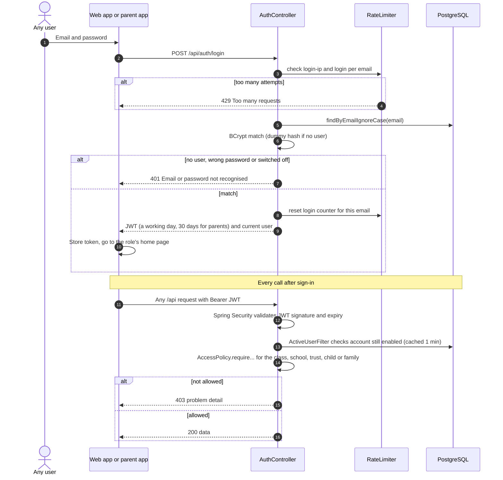
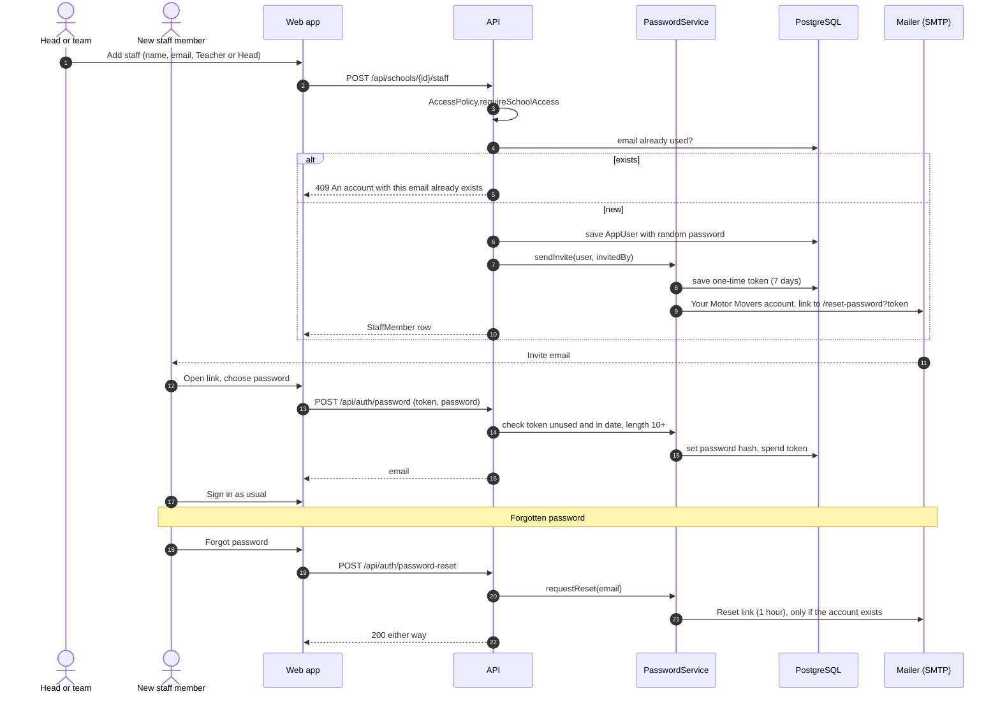
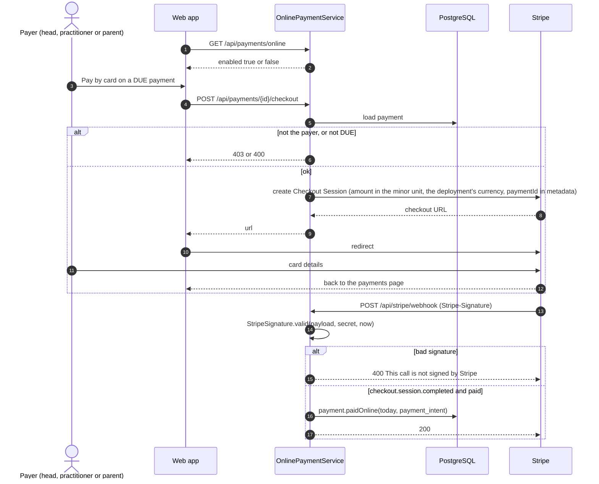
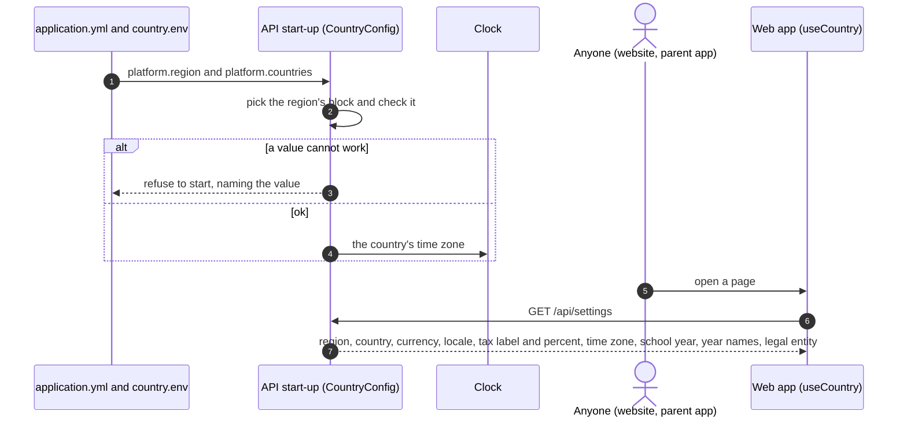

# Everyone: sequence diagrams

Signing in, accounts, paying by card and the country settings. Used by every role.

[All roles](README.md) · Traced from the code at commit 93da753 (4 Nov 2026). Errors are problem details: 400 a rule broken, 403 no access, 429 a rate limit. When an endpoint or rule shown here changes, update the diagram in the same pull request.

## Flows

1. [Sign in and every request after it](#sign-in)
2. [Staff invite, set password and reset](#invite)
3. [Pay by card (Stripe Checkout)](#pay-card)
4. [The country settings](#country)

## Sign in and every request after it

How a token is issued, then checked on every call, before AccessPolicy decides what the caller may see.

**Endpoints:** `POST /api/auth/login` · `GET /api/auth/me`

**Rules in the code**

- Unknown emails are still checked against a dummy hash, so a wrong email takes as long as a wrong password.
- Login is limited to 50 per address and 10 per email in 15 minutes.
- A switched-off account loses access within a minute, even with a valid token.

## Staff invite, set password and reset

Heads, the team and trust setup create accounts with no usable password. The person sets one from an emailed link. Parents register themselves.

**Endpoints:** `POST /api/schools/{id}/staff` · `POST /api/auth/password` · `POST /api/auth/password-reset` · `POST /api/auth/register`

**Rules in the code**

- Invite links work once, for 7 days. Reset links last 1 hour.
- Passwords are at least 10 characters.
- Register always creates a PARENT account (10 an hour per address).

## Pay by card (Stripe Checkout)

A head paying a school invoice, or a practitioner or parent paying their own, goes to Stripe. Stripe's webhook marks the payment paid.

**Endpoints:** `GET /api/payments/online` · `POST /api/payments/{id}/checkout` · `POST /api/stripe/webhook`

**Rules in the code**

- Only the payer can start checkout, and only for a payment that is DUE.
- The webhook is refused unless Stripe's signature is valid.
- A bank debit still on its way waits for async_payment_succeeded.

## The country settings

Each deployment serves one country: the UK, Ireland or Australia (`PLATFORM_REGION`). Its settings are open to anyone,
so the website and the parent app can show money, tax and year names the way that country does (added 6 Nov 2026,
go-live task 25).

**Endpoints:** `GET /api/settings` (no sign-in)

**Rules in the code**

- One region per deployment; schools are stored with it.
- The platform's clock follows the country's time zone (Australia: Queensland time, no daylight saving).
- Every value can be overridden by an environment variable, `PLATFORM_COUNTRIES_<REGION>_<NAME>`.
- Nothing in the settings is private, so the endpoint needs no sign-in.
