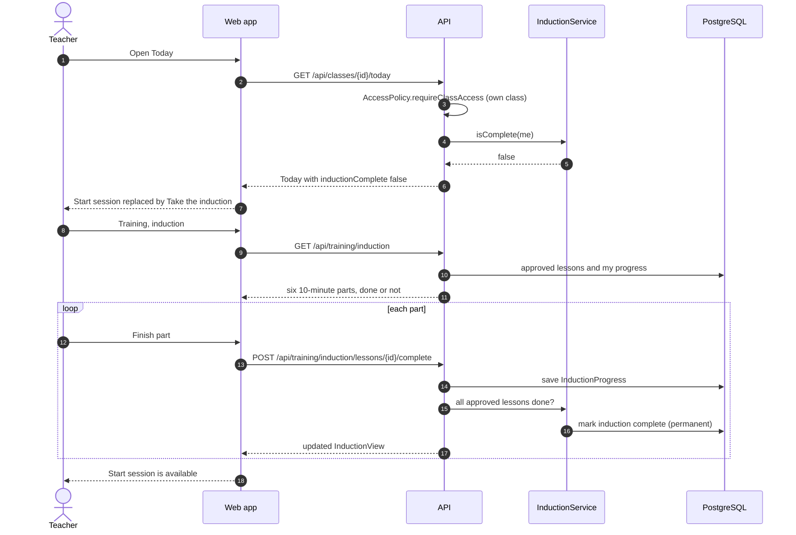
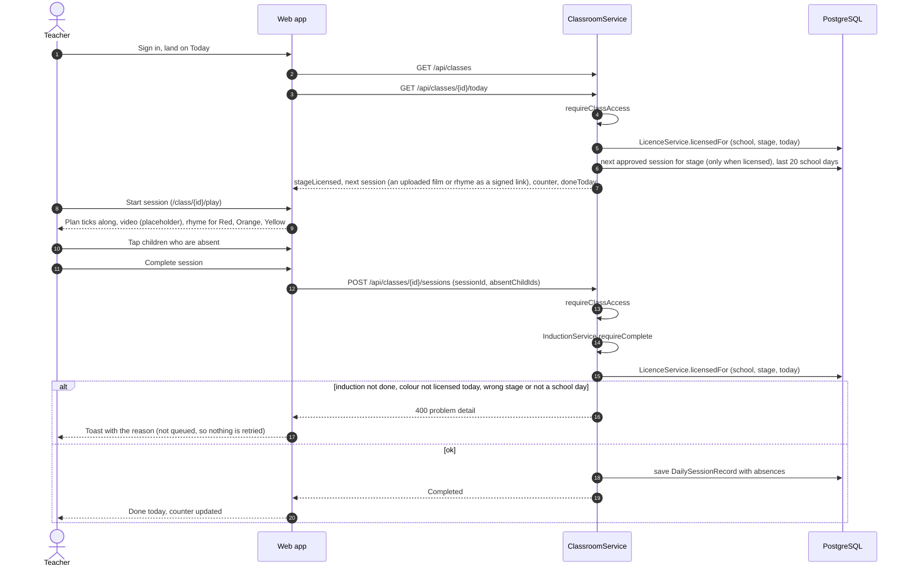
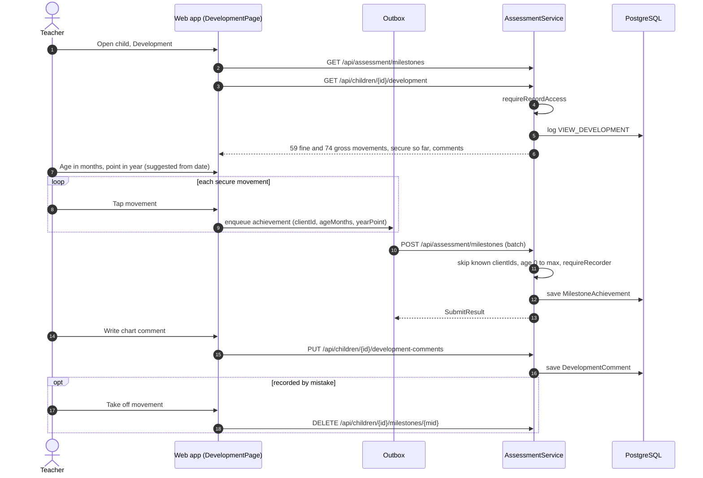
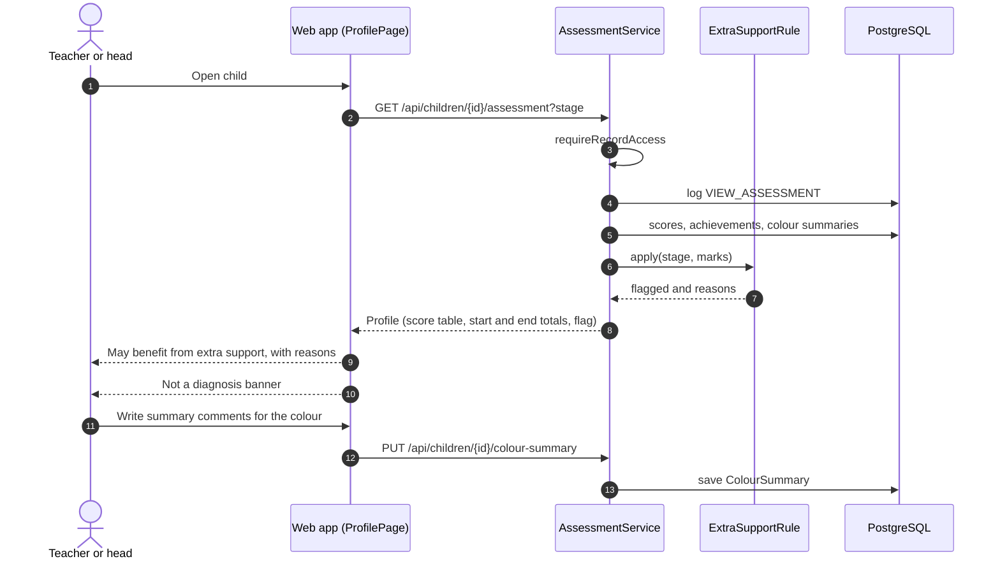
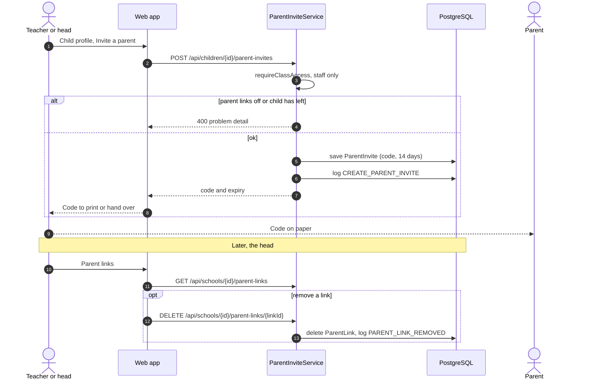

# Class teacher: sequence diagrams

Their own class only: daily sessions, assessments and inviting parents.

[All roles](README.md) · Traced from the code at commit 93da753 (4 Nov 2026). Errors are problem details: 400 a rule broken, 403 no access, 429 a rate limit. When an endpoint or rule shown here changes, update the diagram in the same pull request.

## Flows

1. [Induction gate](#induction)
2. [Run the daily 10-minute session](#daily-session)
3. [Exercise assessment (scores 1 to 4, works offline)](#exercise-assessment)
4. [Developmental assessment (fine and gross motor charts)](#developmental)
5. [Child's assessment profile and the extra-support flag](#profile)
6. [Invite a parent to the app](#parent-invite)

<a id="induction"></a>

## Induction gate

Until the one-hour induction is done, Today shows a link to it instead of Start session, and the API refuses to record a session.

**Endpoints:** `GET /api/classes/{id}/today` · `GET /api/training/induction` · `POST /api/training/induction/lessons/{id}/complete`



**Rules in the code**

- Only approved lessons count.
- Finishing is permanent: lessons added later do not lock anyone out.
- The induction is for school staff only.

<a id="daily-session"></a>

## Run the daily 10-minute session

Today picks the next session for the class's colour stage. The player runs the plan, the teacher marks absences, then completes it.

**Endpoints:** `GET /api/classes` · `GET /api/classes/{id}/today` · `POST /api/classes/{id}/sessions`



**Rules in the code**

- The class's colour must be licensed today: one of the school's licences has started, has not ended, and covers
  the colour (`Licence.isValidOn`, `LicenceService.licensedFor`). Today hides the session otherwise, and recording
  refuses it with "This class's colour is not covered by your school's licence today. Please ask your head teacher."
  A later renewal for other colours does not hide a licence still running.
- The session must belong to the class's colour stage.
- Sessions are recorded on school days only.
- The 20-day counter on Today shows when a class is quietly dropping off.

<a id="exercise-assessment"></a>

## Exercise assessment (scores 1 to 4, works offline)

The class does one exercise together and the teacher scores every child at one point. Scores queue on the device and go when online.

**Endpoints:** `GET /api/classes/{id}/exercise-sheet` · `POST /api/assessment/exercise-scores`

```mermaid
sequenceDiagram
  autonumber
  actor T as Teacher
  participant W as Web app (AssessPage)
  participant Q as Outbox (localStorage)
  participant API as AssessmentService
  participant DB as PostgreSQL
  T->>W: Assess children
  W->>API: GET /api/classes/{id}/exercise-sheet?stage
  API->>API: requireClassAccess
  API->>DB: exercises for stage, children, existing scores
  API-->>W: ClassSheet
  W->>W: suggestedPoint (Start, End of module n, End of colour)
  loop each child
    T->>W: Score 1 Not yet ... 4 Confident and accurate
    W->>Q: enqueue score with new clientId
  end
  W->>Q: flush (now, and again when back online)
  Q->>API: POST /api/assessment/exercise-scores (batch)
  loop each score
    API->>DB: clientId already stored?
    alt already stored
      API->>API: skip (duplicate resend)
    else new
      API->>API: requireRecorder (record access, not trust lead, not a leaver)
      API->>API: point valid for exercise, score 1 to 4, not backdated too far
      API->>DB: rescore existing at same point, or save ExerciseScore
      API->>DB: school child: move up to the exercise's colour (first score places them; never down)
      API->>DB: ChildAccessLog entry
    end
  end
  API-->>Q: SubmitResult
  Q->>Q: remove sent items
  alt network fails or server unavailable
    Q->>Q: keep queue, retry later
  else 400 (the server will never accept it)
    Q->>API: resend the batch one score at a time
    Q->>Q: drop only the refused scores
    W-->>T: Toast with each reason
  end
```

**Rules in the code**

- Each score has a clientId, so resending is safe.
- A score the server refuses (400) is dropped from the queue with a toast saying why, so one bad record never blocks
  the rest or is retried for ever (`outbox.ts`, the same for movements).
- A later score at the same point replaces the earlier one.
- Trust leads cannot record. Children who have left cannot be scored.
- The suggested point waits until every child is scored, unless half the class is already further on.
- A school child works at the colour they are assessed at: their first score places them, a later colour moves them up, never down (home children follow HomeRules).

<a id="developmental"></a>

## Developmental assessment (fine and gross motor charts)

At the start, middle and end of the school year the teacher marks each movement the child can do securely, with the child's age in months.

**Endpoints:** `GET /api/assessment/milestones` · `GET /api/children/{id}/development` · `POST /api/assessment/milestones` · `PUT /api/children/{id}/development-comments` · `DELETE /api/children/{id}/milestones/{mid}`



**Rules in the code**

- No date of birth is held, only age in months.
- Once secure a movement stays secure, unless removed as a mistake.
- Viewing is logged as VIEW_DEVELOPMENT.

<a id="profile"></a>

## Child's assessment profile and the extra-support flag

Both assessments, Pat's score table and summary comments. A pattern of low scores shows 'May benefit from extra support', never a cause.

**Endpoints:** `GET /api/children/{id}/assessment` · `PUT /api/children/{id}/colour-summary`



**Rules in the code**

- Flag: 1 or 2 on the same exercise at two points in a row, or on half or more of the exercises (at least two) at a module or colour end.
- The profile carries a permanent Not a diagnosis banner. (The older 0 to 3 readiness check was retired on 2026-11-04.)

<a id="parent-invite"></a>

## Invite a parent to the app

Staff create a one-time code for a child. The parent types it in the app (see the parent's flows).

**Endpoints:** `POST /api/children/{id}/parent-invites` · `GET /api/schools/{id}/parent-links` · `DELETE /api/schools/{id}/parent-links/{linkId}`



**Rules in the code**

- Only school staff, only while the school has parent links on, only for a child still on roll.
- Codes last 14 days.
- Heads can see and revoke every link.
