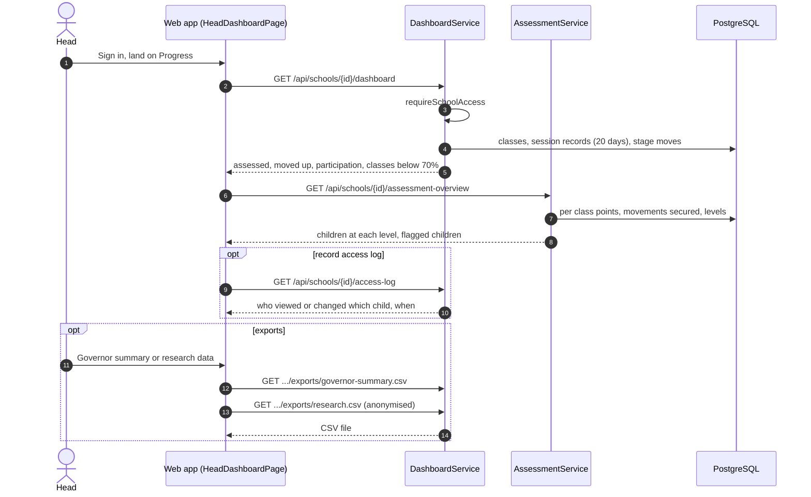
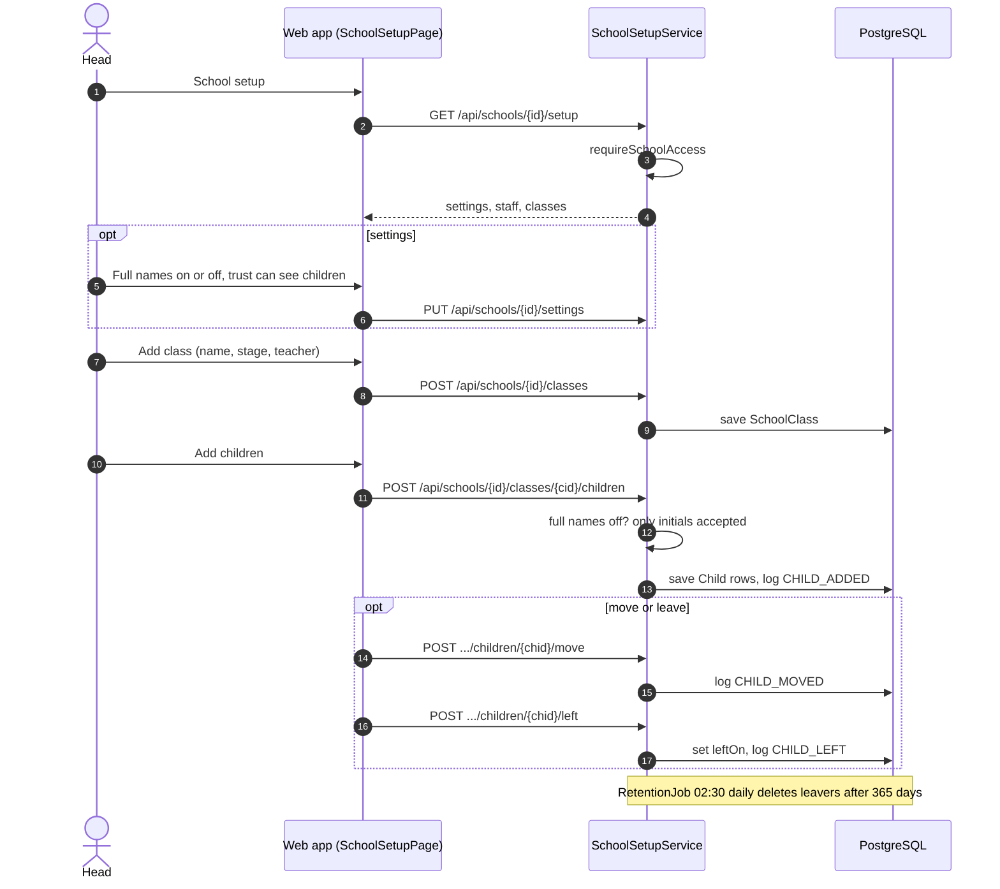
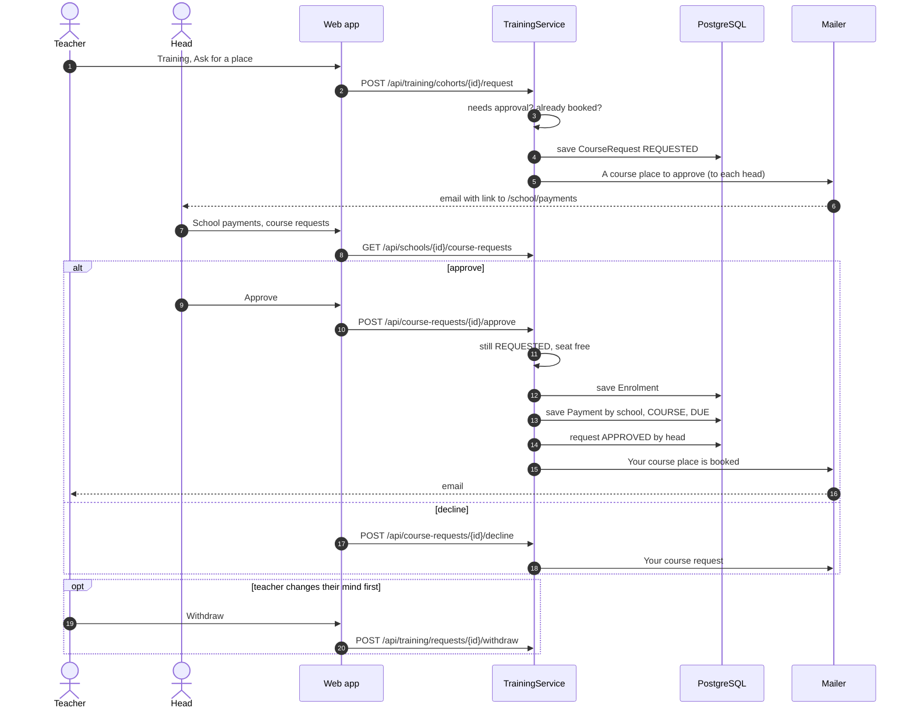

# Head teacher / SENCo: sequence diagrams

Their school: progress, setup, staff course places and payments.

[All roles](README.md) · Traced from the code at commit 93da753 (4 Nov 2026). Errors are problem details: 400 a rule broken, 403 no access, 429 a rate limit. When an endpoint or rule shown here changes, update the diagram in the same pull request.

## Flows

1. [Progress dashboard and exports](#head-dashboard)
2. [School setup: staff, classes and children](#school-setup)
3. [Approve a staff course place](#course-approval)

## Progress dashboard and exports

Participation by class (below 70% flagged), assessments by class, flagged children, the record access log and two CSV exports.

**Endpoints:** `GET /api/schools/{id}/dashboard` · `GET /api/schools/{id}/assessment-overview` · `GET /api/schools/{id}/access-log` · `GET /api/schools/{id}/exports/governor-summary.csv` · `GET /api/schools/{id}/exports/research.csv`

**Rules in the code**

- requireSchoolAccess: the head's own school, or the team.
- The research export is anonymised.
- Participation looks back 20 school days.

## School setup: staff, classes and children

The head (or the team for them) adds staff, classes and children, moves children and marks leavers.

**Endpoints:** `GET /api/schools/{id}/setup` · `PUT /api/schools/{id}/settings` · `POST /api/schools/{id}/classes` · `POST /api/schools/{id}/classes/{cid}/children` · `POST /api/schools/{id}/children/{chid}/move` · `POST /api/schools/{id}/children/{chid}/left`

**Rules in the code**

- Children are initials unless the school switches full names on. While off, full names are refused and never sent.
- Leavers are deleted 365 days after leaving (RetentionJob).
- Every add, move and leave is in the record access log.

## Approve a staff course place

Staff whose school pays ask for a place. The head approves it, which books the place and invoices the school.

**Endpoints:** `POST /api/training/cohorts/{id}/request` · `GET /api/schools/{id}/course-requests` · `POST /api/course-requests/{id}/approve` · `POST /api/course-requests/{id}/decline` · `POST /api/training/requests/{id}/withdraw`

**Rules in the code**

- Approval is needed when the learner has a school, is not a head, and the course costs money.
- Approving checks the cohort still has a seat.
