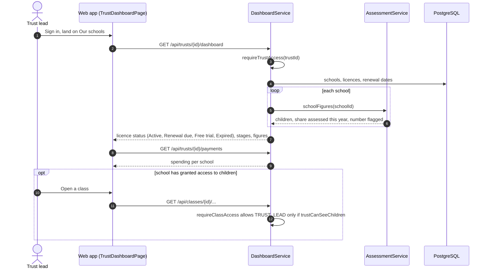

# Trust or group lead: sequence diagrams

Summaries per school. Never individual children unless a school grants it.

[All roles](README.md) · Traced from the code at commit 93da753 (4 Nov 2026). Errors are problem details: 400 a rule broken, 403 no access, 429 a rate limit. When an endpoint or rule shown here changes, update the diagram in the same pull request.

## Flows

1. [Our schools and spending](#trust-dashboard)

## Our schools and spending

One row per school with licence status, stages and summary results, plus spending per school.

**Endpoints:** `GET /api/trusts/{id}/dashboard` · `GET /api/trusts/{id}/payments`

**Rules in the code**

- requireTrustAccess: the lead's own trust, or the team.
- Class and child data only where the school has switched on trust access to children.
- Trust leads can never record assessments.
