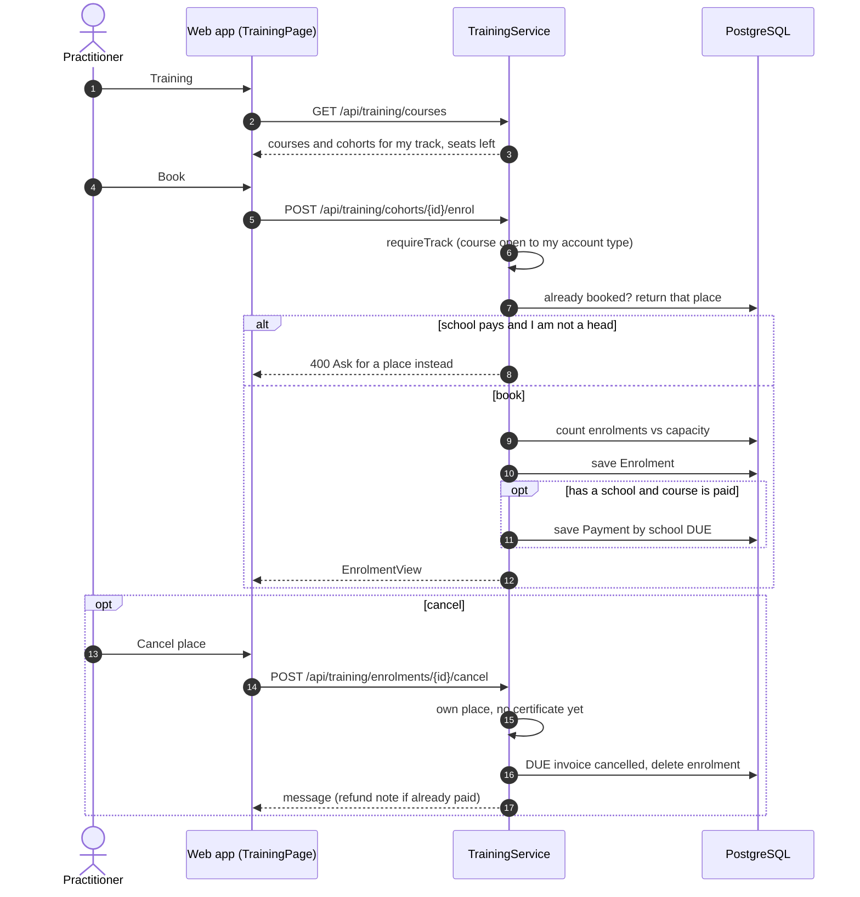
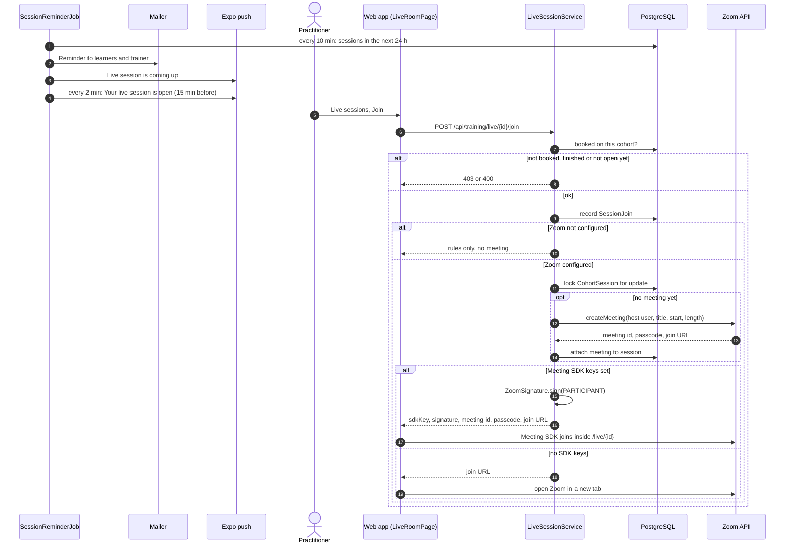
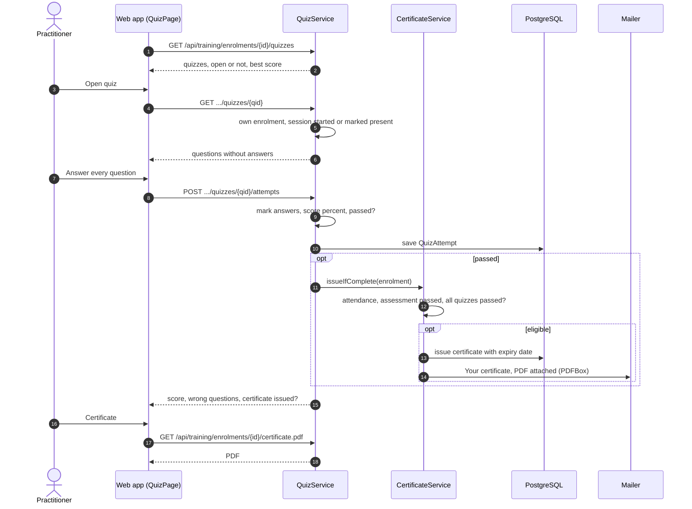

# Practitioner: sequence diagrams

Recorded courses: booking, the lessons in order, the test and the certificate. Live courses on Zoom are kept behind a setting that is off.

[All roles](README.md) · Traced from the code at commit 93da753 (4 Nov 2026). Errors are problem details: 400 a rule broken, 403 no access, 429 a rate limit. When an endpoint or rule shown here changes, update the diagram in the same pull request.

## Flows

0. [Recorded courses: book, do the lessons, take the test](#recorded)
1. [Book or cancel a course place](#book)
2. [Reminders and joining a live session](#join-live)
3. [Quizzes and the certificate](#quiz-cert)

<a id="recorded"></a>

## Recorded courses: book, do the lessons, take the test

Since go-live task 89 a course is a set of ordered lessons, each a film with optional text and slides. A learner has a place on the course itself, with no cohort, and starts at once. Parents take the parent course the same way (on the website; the parent app lists the lessons and opens each film).

**Endpoints:** `GET /api/training/courses` · `POST /api/training/courses/{id}/enrol` · `POST /api/training/courses/{id}/request` · `GET /api/training/enrolments/mine` · `GET /api/training/enrolments/{id}/lessons` · `POST /api/training/enrolments/{id}/lessons/{lessonId}/complete` · `GET /api/training/enrolments/{id}/quizzes` · `POST /api/training/enrolments/{id}/quizzes/{quizId}/attempts` · `GET /api/training/enrolments/{id}/certificate.pdf` · `POST /api/training/enrolments/{id}/cancel`

```mermaid
sequenceDiagram
  autonumber
  actor L as Learner
  participant W as Website
  participant T as TrainingService
  participant C as CourseLessonService
  participant Q as QuizService
  participant Cert as CertificateService
  participant DB as PostgreSQL
  participant M as Mailer
  L->>W: Training
  W->>T: GET /api/training/courses
  T-->>W: each course: lessons, minutes, tests, place (NONE, BOOKED, REQUESTED), needsApproval
  alt staff whose school pays (not a head)
    L->>W: Ask for a place
    W->>T: POST /api/training/courses/{id}/request
    T->>M: the school's heads: a course place to approve
    Note over T: the head approves on the school's Payments page, which books the place and invoices the school
  else parent, practitioner or head
    L->>W: Book a place
    W->>T: POST /api/training/courses/{id}/enrol
    T->>DB: enrolment (course, no cohort); a head's school is invoiced
  end
  L->>W: Start the course
  W->>C: GET /api/training/enrolments/{id}/lessons
  C-->>W: approved lessons in order: done, open, and a signed film link for an open lesson only
  L->>W: plays lesson 1's film to the end, then Mark as done
  W->>C: POST .../lessons/{lessonId}/complete
  C->>DB: course_lesson_progress (refused if an earlier lesson is not done)
  C-->>W: lesson 2 is open
  Note over L,C: after the last lesson the course's tests open
  L->>W: Take the test
  W->>Q: POST .../quizzes/{quizId}/attempts
  Q->>DB: quiz_attempt, marked on the server
  Q->>Cert: issueIfComplete
  Cert->>DB: certificate issued (every lesson done, every test passed)
  Cert->>M: the certificate, with its PDF
```

**Rules in the code**

- A place and its lessons, with their film and slides links, are for the learner whose place it is and the team (`AccessPolicy.requireCoursePlace`); only the learner marks a lesson done (`requireOwnCoursePlace`). A head, a trainer or another learner gets 403.
- Learners see approved lessons only. The team writes lessons as drafts and approves them, with the wording check, on Content approval, Course lessons (`/api/admin/courses/{id}/lessons`, `/api/admin/lessons/{id}`); a lesson that is changed goes back to a draft, and one learners have done cannot be deleted.
- Lessons go in order: a lesson's links are sent, and it can be marked done, only once every lesson before it is done. The website offers Mark as done once the lesson's film has played to its end (at any time for a lesson with no film).
- A course with no approved lessons cannot be booked.
- The tests of a recorded place open when every approved lesson is done. `CertificateService.issueIfComplete` is the one place a certificate is issued: every lesson done and every test passed, on a course that awards one. The starter practitioner course has one final test of ten questions with a pass mark of 80%.
- A learner (or their head, for staff) can cancel until the first lesson is done; the team any time before a certificate. A school's invoice still due is cancelled with the place.
- The parent app lists a place's lessons and opens each open lesson's film; marking a lesson done and the test are on the website.

<a id="book"></a>

> **Live courses are switched off by default (go-live task 89).** Courses are recorded: see [Recorded courses](4-practitioner.md#recorded). What this section shows runs only in a deployment started with `LIVE_COURSES=true`; with it off, every endpoint here answers 404 and the screens are hidden.


## Book or cancel a course place

The catalogue shows courses for the account's track. Booking takes a seat. For staff with a school, the school is invoiced.

**Endpoints:** `GET /api/training/courses` · `POST /api/training/cohorts/{id}/enrol` · `GET /api/training/enrolments/mine` · `POST /api/training/enrolments/{id}/cancel`



**Rules in the code**

- A full cohort refuses the booking.
- Cancelling cancels a DUE invoice. A PAID one is refunded by the team.
- A place cannot be cancelled once the certificate is issued.

<a id="join-live"></a>

> **Live courses are switched off by default (go-live task 89).** Courses are recorded: see [Recorded courses](4-practitioner.md#recorded). What this section shows runs only in a deployment started with `LIVE_COURSES=true`; with it off, every endpoint here answers 404 and the screens are hidden.


## Reminders and joining a live session

Reminders go out 24 hours ahead. From 15 minutes before the start the learner can join, inside the portal or in Zoom.

**Endpoints:** `GET /api/training/live` · `POST /api/training/live/{id}/join`



**Rules in the code**

- Only booked learners can join, from 15 minutes before until the session ends.
- The first person to join creates the Zoom meeting, under a row lock so only one is made.
- Without the Meeting SDK keys the session opens in Zoom in a new tab. The parent app always uses the Zoom app.

<a id="quiz-cert"></a>

## Quizzes and the certificate

Each quiz opens when its live session starts. When attendance, quizzes and the end-of-course assessment are all done, the certificate is emailed as a PDF.

**Endpoints:** `GET /api/training/enrolments/{id}/quizzes` · `GET .../quizzes/{qid}` · `POST .../quizzes/{qid}/attempts` · `GET /api/training/enrolments/{id}/certificate.pdf`



**Rules in the code**

- Only the learner takes their quizzes, and every question must be answered.
- Certificate eligibility is checked after a quiz pass, a register mark and the trainer's assessment.
- Daily at 08:00 learners whose certificate is close to expiry are emailed.
