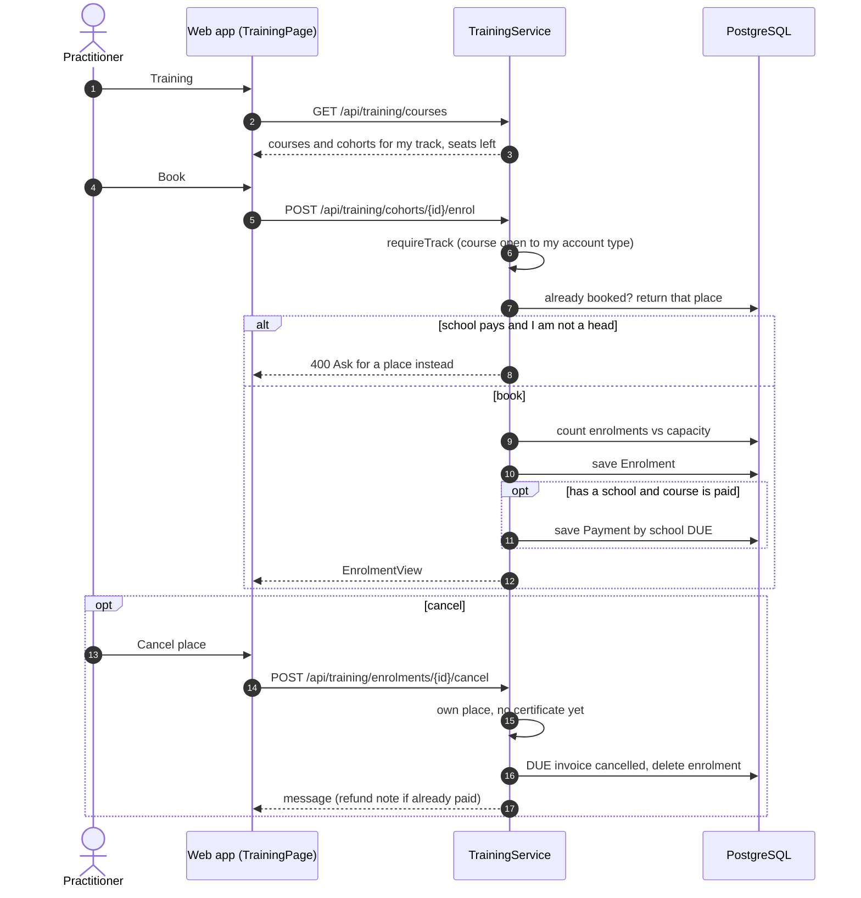
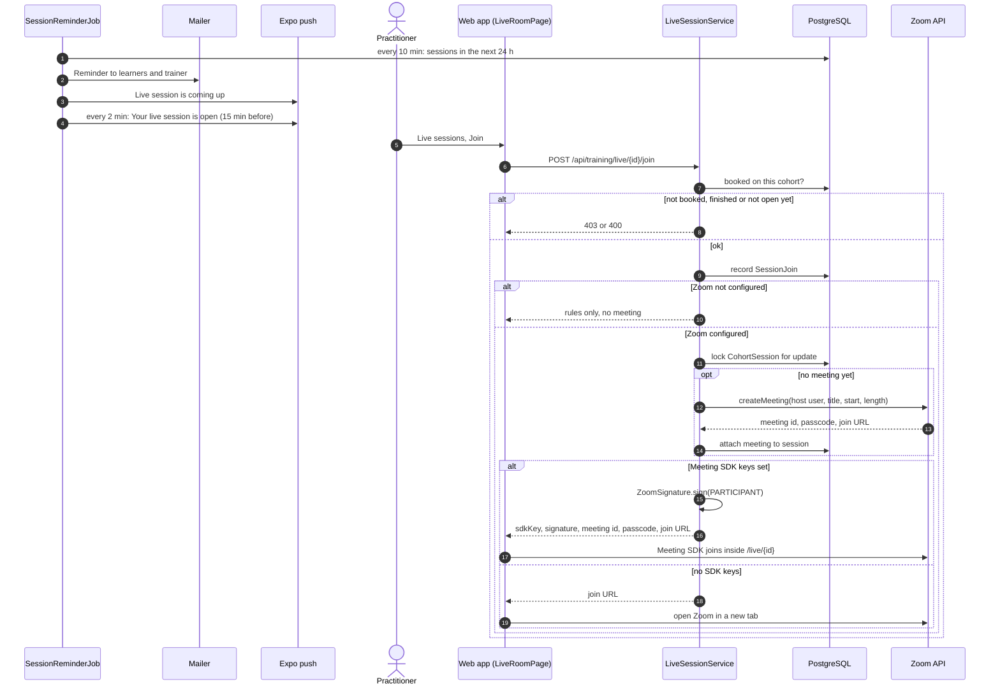
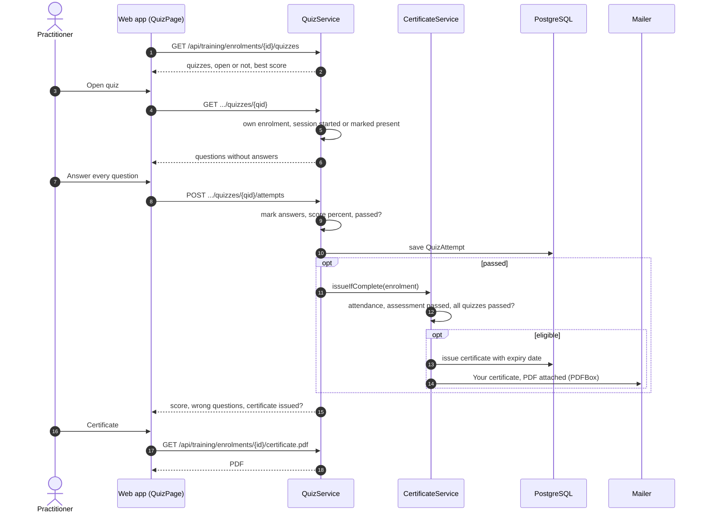

# Practitioner: sequence diagrams

Live courses: booking, joining on Zoom, quizzes and the certificate.

[All roles](README.md) · Traced from the code at commit 93da753 (4 Nov 2026). Errors are problem details: 400 a rule broken, 403 no access, 429 a rate limit. When an endpoint or rule shown here changes, update the diagram in the same pull request.

## Flows

1. [Book or cancel a course place](#book)
2. [Reminders and joining a live session](#join-live)
3. [Quizzes and the certificate](#quiz-cert)

## Book or cancel a course place

The catalogue shows courses for the account's track. Booking takes a seat. For staff with a school, the school is invoiced.

**Endpoints:** `GET /api/training/courses` · `POST /api/training/cohorts/{id}/enrol` · `GET /api/training/enrolments/mine` · `POST /api/training/enrolments/{id}/cancel`

**Rules in the code**

- A full cohort refuses the booking.
- Cancelling cancels a DUE invoice. A PAID one is refunded by the team.
- A place cannot be cancelled once the certificate is issued.

## Reminders and joining a live session

Reminders go out 24 hours ahead. From 15 minutes before the start the learner can join, inside the portal or in Zoom.

**Endpoints:** `GET /api/training/live` · `POST /api/training/live/{id}/join`

**Rules in the code**

- Only booked learners can join, from 15 minutes before until the session ends.
- The first person to join creates the Zoom meeting, under a row lock so only one is made.
- Without the Meeting SDK keys the session opens in Zoom in a new tab. The parent app always uses the Zoom app.

## Quizzes and the certificate

Each quiz opens when its live session starts. When attendance, quizzes and the end-of-course assessment are all done, the certificate is emailed as a PDF.

**Endpoints:** `GET /api/training/enrolments/{id}/quizzes` · `GET .../quizzes/{qid}` · `POST .../quizzes/{qid}/attempts` · `GET /api/training/enrolments/{id}/certificate.pdf`

**Rules in the code**

- Only the learner takes their quizzes, and every question must be answered.
- Certificate eligibility is checked after a quiz pass, a register mark and the trainer's assessment.
- Daily at 08:00 learners whose certificate is close to expiry are emailed.
