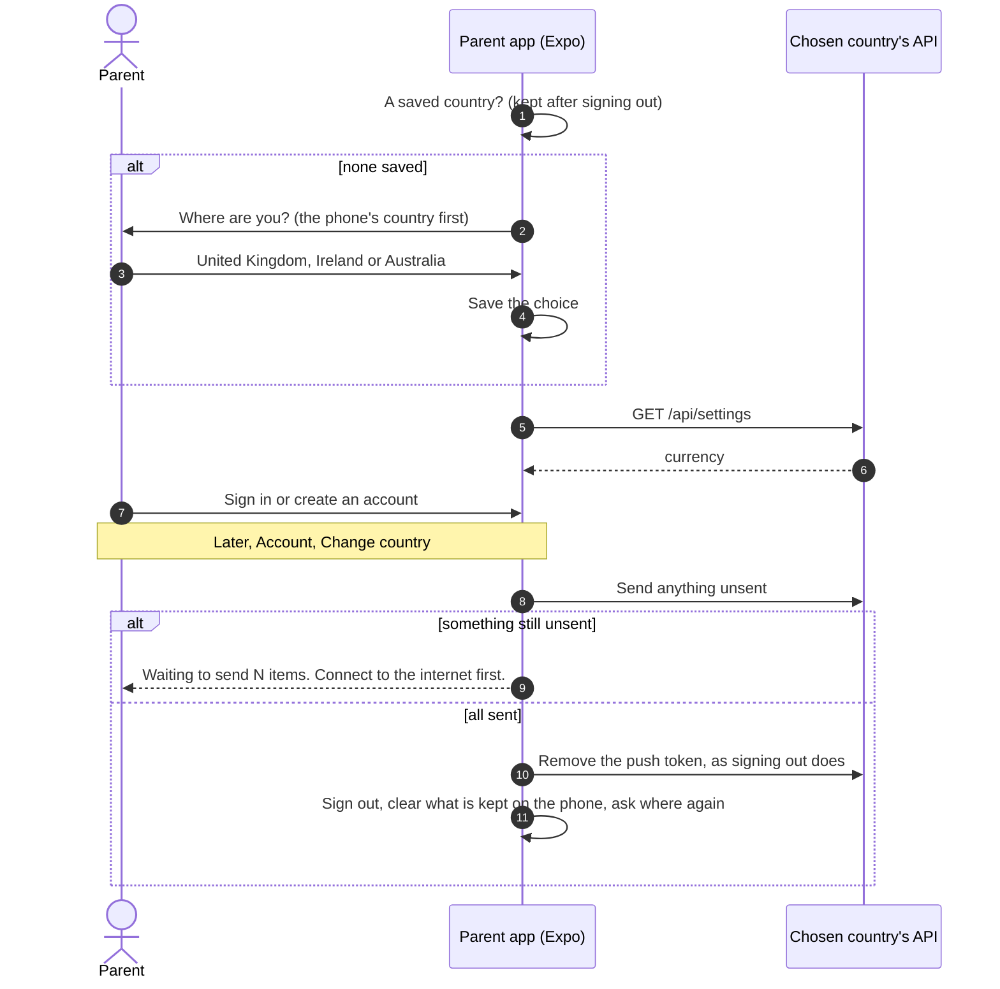
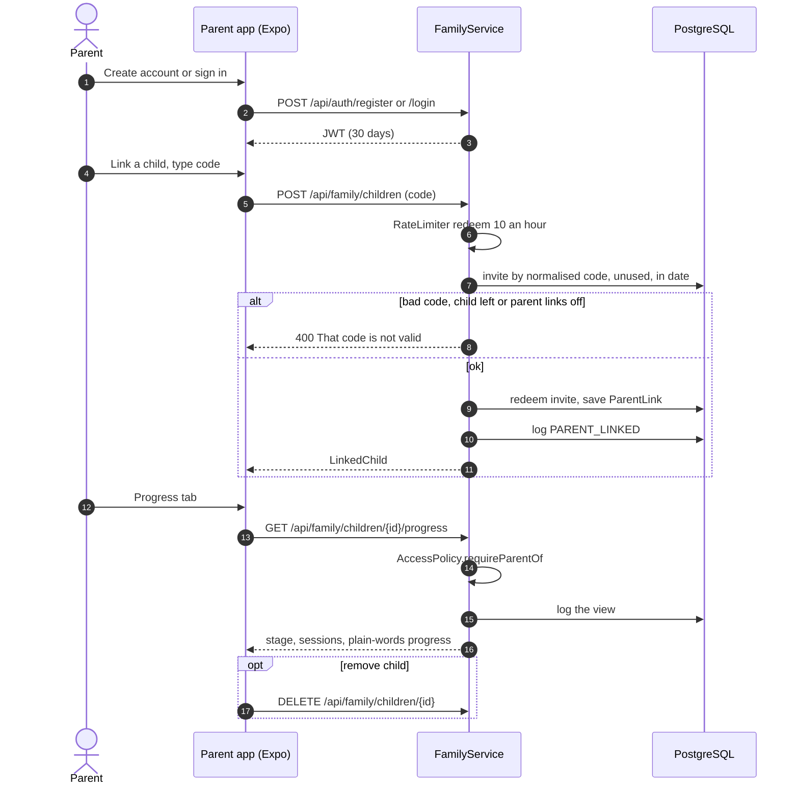
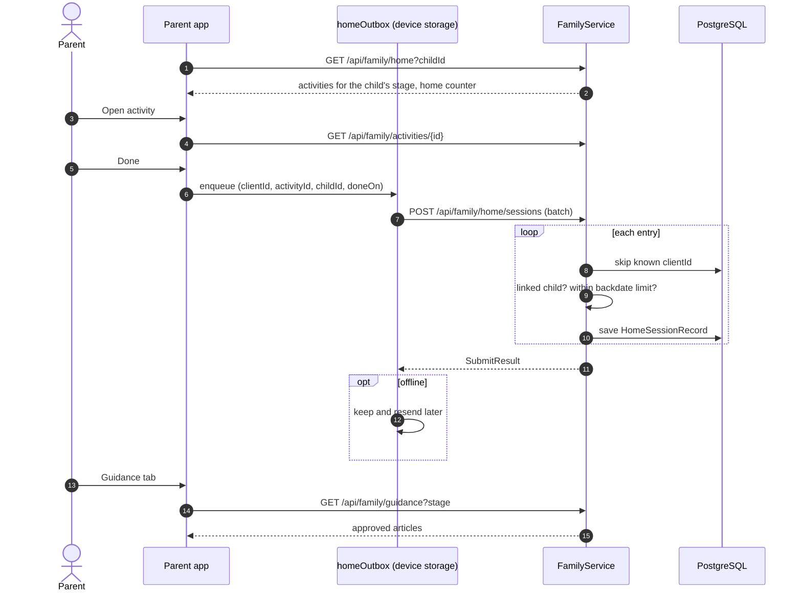
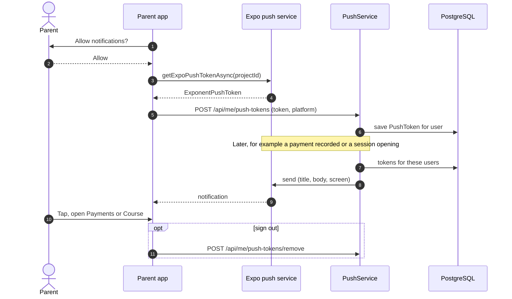

# Parent (school child): sequence diagrams

The parent app and the parent course, for a child whose school is on Motor Movers.

[All roles](README.md) · Traced from the code at commit 93da753 (4 Nov 2026). Errors are problem details: 400 a rule broken, 403 no access, 429 a rate limit. When an endpoint or rule shown here changes, update the diagram in the same pull request.

## Flows

1. [First launch: where are you?](#first-launch)
2. [Link a child and see progress](#link-child)
3. [Home activities and guidance (works offline)](#home-activities)
4. [Phone notifications](#push)

## First launch: where are you?

One store app serves three countries, each with its own server. The parent says where they are before signing in, and the choice decides where every request goes.

**Endpoints:** `GET /api/settings`, on the chosen country's server

**Rules in the code**

- The address comes from the build (`EXPO_PUBLIC_API_URL_UK`, `_IE`, `_AU`) and is read on every request.
- The parent is always asked; the phone's region only puts its country first.
- Changing country is refused while sessions or ratings are unsent: they belong on the old country's server.

## Link a child and see progress

The parent types the school's code in the app. The school's link decides what they can see, in plain words.

**Endpoints:** `POST /api/auth/register` · `POST /api/family/children` · `GET /api/family/children` · `GET /api/family/children/{id}/progress` · `DELETE /api/family/children/{id}`

**Rules in the code**

- 10 code attempts an hour per account.
- Parents see a child only through the school's link, while parent links are on and the child is on roll.
- Parents see plain words, not scores or the flag. Each view is in the school's access log.

## Home activities and guidance (works offline)

The app shows the approved activities for the child's colour. Done activities queue on the phone and are sent when online.

**Endpoints:** `GET /api/family/home` · `GET /api/family/activities/{id}` · `POST /api/family/home/sessions` · `GET /api/family/guidance`

**Rules in the code**

- clientId makes resending safe.
- Sessions can only be backdated a few days.

## Phone notifications

The app registers its Expo push token. The API sends through Expo for live sessions and payments due.

**Endpoints:** `POST /api/me/push-tokens` · `POST /api/me/push-tokens/remove`

**Rules in the code**

- Off until PUSH_ENABLED=true and the EAS project id is set.
- A tap opens the screen named in the message, for example Payments.
