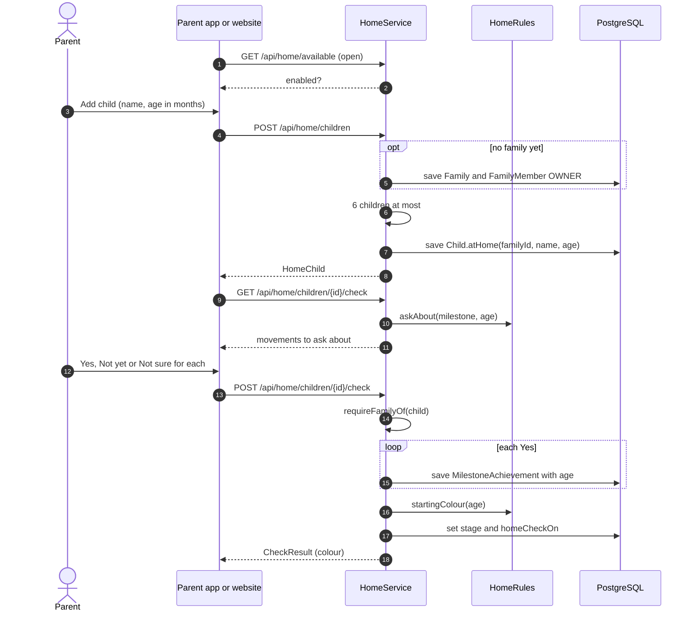
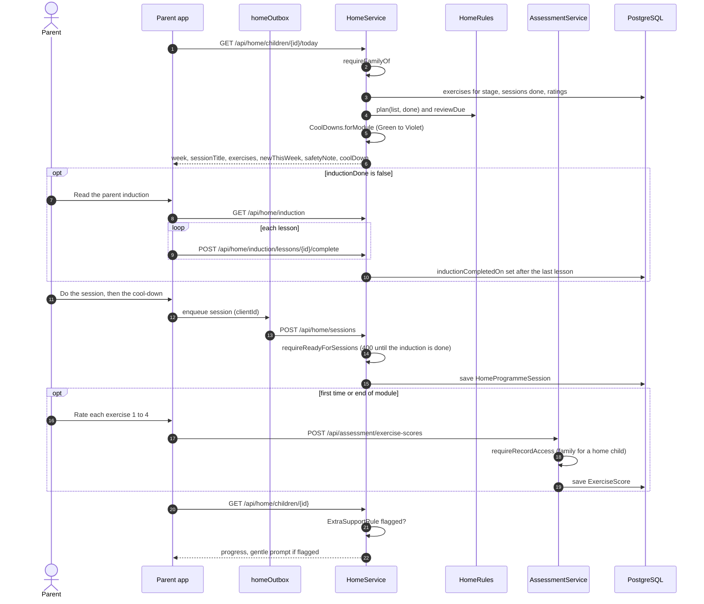
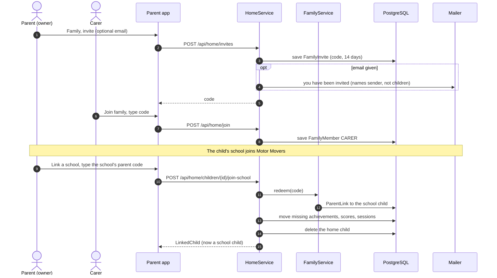

# Parent (Motor Movers at Home): sequence diagrams

Families whose school is not on Motor Movers. Behind HOME_PROGRAMME, off in production.

The app asks which country the parent is in at first launch: see [First launch](5a-parent-school-child.md#first-launch).

[All roles](README.md) · Traced from the code at commit 93da753 (4 Nov 2026). Errors are problem details: 400 a rule broken, 403 no access, 429 a rate limit. When an endpoint or rule shown here changes, update the diagram in the same pull request.

## Flows

1. [Add a child and do the starting check](#home-add-check)
2. [Today's home session and ratings](#home-today)
3. [Share with another carer, or move to a school](#home-family)
4. [Buy or renew the family's pass](#home-pass)

<a id="home-add-check"></a>

## Add a child and do the starting check

The first child creates the family. The check asks about movements up to the child's age and sets the starting colour.

**Endpoints:** `GET /api/home/available` · `POST /api/home/children` · `GET /api/home/children/{id}/check` · `POST /api/home/children/{id}/check`



**Rules in the code**

- Up to 6 children a family.
- Children start at Orange when young and Green from school age (Red under 2, to confirm).
- The check only records movements. It is suggested again at the start, middle and end of each school year.

<a id="home-today"></a>

## Today's home session and ratings

HomeRules builds today's plan: one rhyme a week for the rhyme colours, modules built up over five weeks from Green on.

**Endpoints:** `GET /api/home/children/{id}/today` · `GET /api/home/induction` · `POST /api/home/induction/lessons/{id}/complete` · `POST /api/home/sessions` · `POST /api/assessment/exercise-scores` · `GET /api/home/children/{id}`



**Rules in the code**

- A parent finishes the parent induction before their first session; each carer does their own. The API refuses a
  session until then, and finishing is permanent: lessons added later lock nobody out.
- The safety note shows before the first session.
- From Green to Violet the session ends with the module's cool-down (the colour's last one past module 6); a rhyme
  ends with its own, in its words (Pat, 2026-11-05).
- Sessions, the check and ratings need a running family pass as well as the induction (flow 4).
- Parents rate with the same 1 to 4 scale. A flag shows only the gentle prompt (nursery or health visitor).

<a id="home-pass"></a>

## Buy or renew the family's pass

Sessions, the starting check and ratings need the family's 12-month pass (go-live task 26). Only Stripe's signed
webhook marks it paid; coming back from Stripe proves nothing.

**Endpoints:** `GET /api/home/pass` · `POST /api/home/pass/checkout` · `POST /api/stripe/webhook` · `GET /api/admin/home-pass/prices` · `POST /api/admin/home-pass/prices` · `GET /api/admin/home-pass/family` · `POST /api/admin/home-pass/extend`

```mermaid
sequenceDiagram
  autonumber
  actor P as Parent
  participant W as Website or app
  participant API as HomePassService
  participant S as Stripe
  participant DB as PostgreSQL
  P->>W: At home (or Today in the app)
  W->>API: GET /api/home/pass
  API->>DB: price today, family's pass rows
  API-->>W: onSale, price, running, endsOn, ended
  P->>W: Buy the pass (or Renew)
  W->>API: POST /api/home/pass/checkout
  API->>DB: HOME_PASS payment DUE (tax included) and a pass row without dates; reused if pressed again
  API->>S: Checkout page, back to /home?paid=1
  API-->>W: url
  W->>S: pay by card
  S->>API: POST /api/stripe/webhook (signed)
  API->>DB: payment PAID, event Paid
  API->>DB: pass runs from today, or from the day after the running pass ends, for 12 months
  Note over API,DB: Daily 08:15: reminders 30 and 7 days before the end and on the day, once each (home_pass_reminder)
```

**Rules in the code**

- A running pass covers the whole family: every child at home and every carer. A child linked to a school needs none.
- The parent induction is checked first, then the pass; the API refuses with a problem detail saying which is missing.
- While locked, Today sends no session (no exercises, review or cool-down); the family's own data stays open to it.
- A pass refunded in full ends on the day of the refund; a partial refund leaves it.
- The team extends a pass by hand (recorded with who and why), and sets the price from today or later only.

<a id="home-family"></a>

## Share with another carer, or move to a school

An owner invites a carer by code or email. If the child's school joins later, the home record moves onto the school's record.

**Endpoints:** `POST /api/home/invites` · `POST /api/home/join` · `DELETE /api/home/members/{id}` · `POST /api/home/children/{id}/join-school`



**Rules in the code**

- Invite emails: 20 a day per account. Joining: 10 tries an hour.
- The last member leaving deletes the family and its records.
- On join-school the school's own rows win; only missing ones move across.
