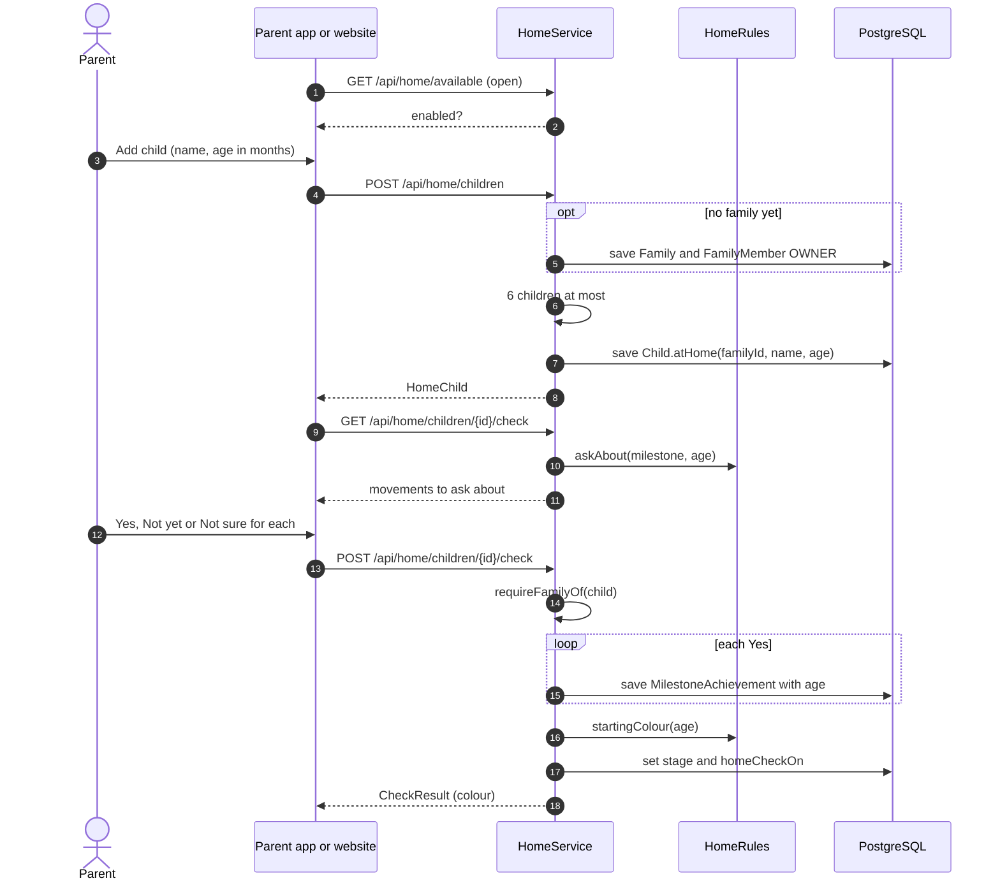
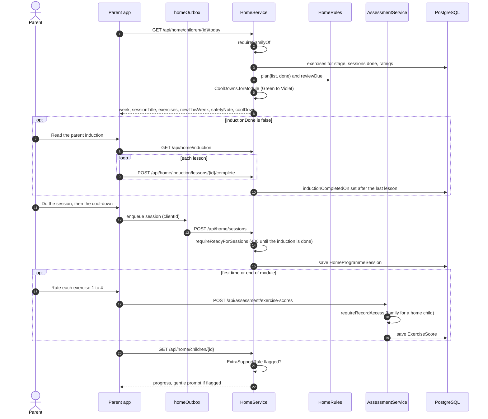
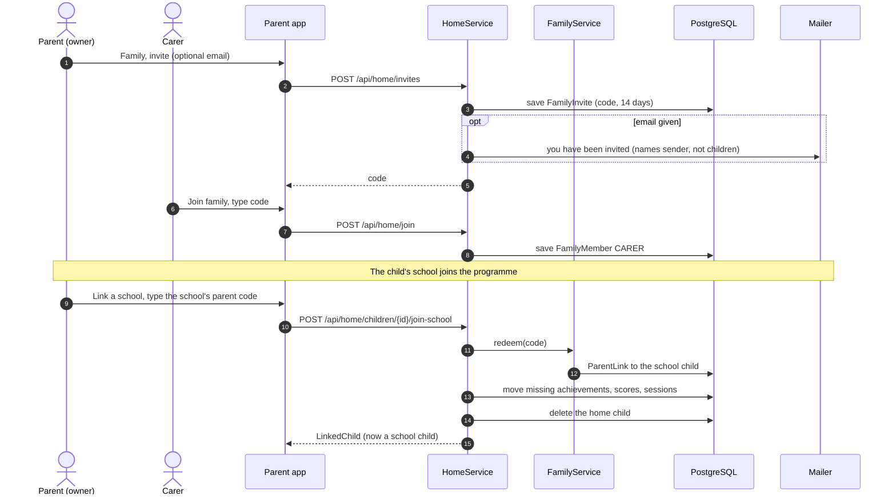

# Parent (the Programme at Home): sequence diagrams

Families whose school is not on the programme. The home programme was called Motor Movers at Home until the rename
of 2026-11-16 (go-live task 84); this file keeps its old name. Behind HOME_PROGRAMME, off in production.

The app asks which country the parent is in at first launch: see [First launch](5a-parent-school-child.md#first-launch).

[All roles](README.md) · Traced from the code at commit 93da753 (4 Nov 2026). Errors are problem details: 400 a rule broken, 403 no access, 429 a rate limit. When an endpoint or rule shown here changes, update the diagram in the same pull request.

## Flows

1. [Add a child and do the starting check](#home-add-check)
2. [Today's home session and ratings](#home-today)
3. [Share with another carer, or move to a school](#home-family)
4. [Subscribe monthly, and manage the subscription](#home-pass)

<a id="home-add-check"></a>

## Add a child and do the starting check

The first child creates the family. The check asks about movements up to the child's age and sets the starting colour.

**Endpoints:** `GET /api/home/available` · `POST /api/home/children` · `GET /api/home/children/{id}/check` · `POST /api/home/children/{id}/check`



**Rules in the code**

- Up to 6 children a family.
- Children start at Orange when young and Green from school age (Red under 2, to confirm).
- The check only records movements. It is suggested again at the start, middle and end of each school year.

<a id="home-today"></a>

## Today's home session and ratings

HomeRules builds today's plan: one rhyme a week for the rhyme colours, modules of six weeks from Green on (built up over five, then week 5 repeated, then the module's review). Today also carries the film of the child's rhyme or module (`videoUrl`, a signed link, and `filmCredit`) and the films of the session's own exercises (`exerciseFilms`) once the pass and induction checks are met; while locked, no link is sent.

**Endpoints:** `GET /api/home/children/{id}/today` · `GET /api/home/induction` · `POST /api/home/induction/lessons/{id}/complete` · `POST /api/home/sessions` · `POST /api/assessment/exercise-scores` · `GET /api/home/children/{id}`



**Rules in the code**

- A parent finishes the parent induction before their first session; each carer does their own. The API refuses a
  session until then, and finishing is permanent: lessons added later lock nobody out.
- The safety note shows before the first session.
- From Green to Violet the session ends with the module's cool-down (the colour's last one past module 6); a rhyme
  ends with its own, in its words (Pat, 2026-11-05).
- Sessions, the check and ratings need the family to be covered today (its subscription) as well as the induction (flow 4).
- Parents rate with the same 1 to 4 scale. A flag shows only the gentle prompt (nursery or health visitor).

<a id="home-pass"></a>

## Subscribe monthly, and manage the subscription

Sessions, the starting check and ratings need the family to be covered today. Since go-live task 68 a family is
covered by a monthly subscription, which Stripe bills; each month Stripe takes becomes a payment (with its tax) and
the days it covers. Only Stripe's signed webhook does this; coming back from Stripe proves nothing. The 12-month pass
(task 26) is no longer sold, but one that still runs, and the team's extensions, cover a family in the same way.

**Endpoints:** `GET /api/home/pass` · `POST /api/home/subscription/checkout` · `POST /api/home/subscription/portal` · `POST /api/stripe/webhook` · `GET /api/admin/home-pass/monthly-prices` · `POST /api/admin/home-pass/monthly-prices` · `GET /api/admin/home-pass/family` · `POST /api/admin/home-pass/extend` · `POST /api/admin/home-pass/cancel-subscription`

```mermaid
sequenceDiagram
  autonumber
  actor P as Parent
  participant W as Website
  participant API as HomeSubscriptionService
  participant S as Stripe
  participant DB as PostgreSQL
  P->>W: At home
  W->>API: GET /api/home/pass
  API->>DB: monthly price today, the family's cover and subscription
  API-->>W: onSale, pricePence, running, endsOn, subscription, renewsOn, canSubscribe, canManage
  P->>W: Subscribe
  W->>API: POST /api/home/subscription/checkout
  API->>DB: lock the family, a home_subscription row PENDING (its page is reused if pressed again)
  API->>S: Checkout page in subscription mode, the row's id in the subscription's metadata
  API-->>W: url
  W->>S: card details, on Stripe's page
  S->>API: checkout.session.completed (signed)
  API->>DB: Stripe's subscription and customer ids
  S->>API: invoice.paid (signed), each month
  API->>DB: a payment PAID with tax (once per invoice), a home_pass row for the invoice's period, subscription ACTIVE
  P->>W: Manage
  W->>API: POST /api/home/subscription/portal
  API->>S: customer portal page
  W->>S: cancel at the end of the month, or change the card
  S->>API: customer.subscription.updated (signed)
  API->>DB: cancelling, and one email with the last day
  S->>API: invoice.payment_failed (signed)
  API->>DB: PAST_DUE, and the payer is told by email and phone, once per invoice
  S->>API: customer.subscription.deleted (signed)
  API->>DB: ENDED; the days already paid for stay
```

**Rules in the code**

- Cover is for the whole family: every child at home and every carer. A child linked to a school needs none.
- One subscription per family. Pressing Subscribe twice opens the same Stripe page; a second carer is told the family
  already subscribes, or that another carer has started. A family still covered by a pass can subscribe from the
  pass's last day.
- A month's cover runs from the day Stripe's period starts to the day it ends, both included: Stripe takes the next
  month about an hour after the period ends, so the renewal day itself must be covered.
- A month is recorded once, however often Stripe sends the message (`payment.stripe_invoice_id` is unique). An invoice
  in another currency, or with no period, is not recorded.
- Stripe's messages are read in both of its shapes: an invoice's subscription under `parent.subscription_details`
  (since its 2025-03-31 version) or at the top, and a cancellation as `cancel_at_period_end` or `cancel_at`.
- A failed payment gives no extra days: cover ends with the month paid for. Stripe retries by itself.
- Only the parent who subscribed opens Stripe's page to cancel or change the card. The team can cancel for a family,
  recorded with who and why: at the end of the paid month, or at once if a payment has failed.
- A parent who pays and leaves the family has the subscription cancelled at the end of the paid month; when the last
  member leaves (the family is deleted), it ends at once.
- A month refunded in full ends that month's cover on the day of the refund. It does not cancel the subscription.
- A change of the monthly price applies to new subscriptions; a family keeps the price it subscribed at.
- The parent induction is checked first, then the cover; the API refuses with a problem detail saying which is missing.
- While locked, Today sends no session (no exercises, review or cool-down); the family's own data stays open to it.
- A session or rating saved offline is accepted if the family was covered on its date (`doneOn`, `assessedOn`), even
  after cover ends; today's and tomorrow's need cover today. The induction is always needed.
- The ending reminders (30 and 7 days before and on the day, daily at 08:15) go only to a family whose last cover is a
  pass or an extension. A subscription renews by itself and gets none.
- The parent app shows where the subscription stands and nothing else: no price, no button and no link to a payment
  page (the app stores' rules on selling subscriptions). Subscribing and managing are on the website.
- With no monthly price in force, monthly is not on sale. Without card payments, "please contact us" gives the
  country's contact email and phone, each left out while it is a placeholder.
- `STRIPE_FAKE=true` (development, demos and the browser tests; production refuses it) swaps Stripe for a stand-in on
  the API, whose pages say what Stripe would say next through the same code as the webhook.

<a id="home-family"></a>

## Share with another carer, or move to a school

An owner invites a carer by code or email. If the child's school joins later, the home record moves onto the school's record.

**Endpoints:** `POST /api/home/invites` · `POST /api/home/join` · `DELETE /api/home/members/{id}` · `POST /api/home/children/{id}/join-school`



**Rules in the code**

- Invite emails: 20 a day per account. Joining: 10 tries an hour.
- The last member leaving deletes the family and its records.
- On join-school the school's own rows win; only missing ones move across.
