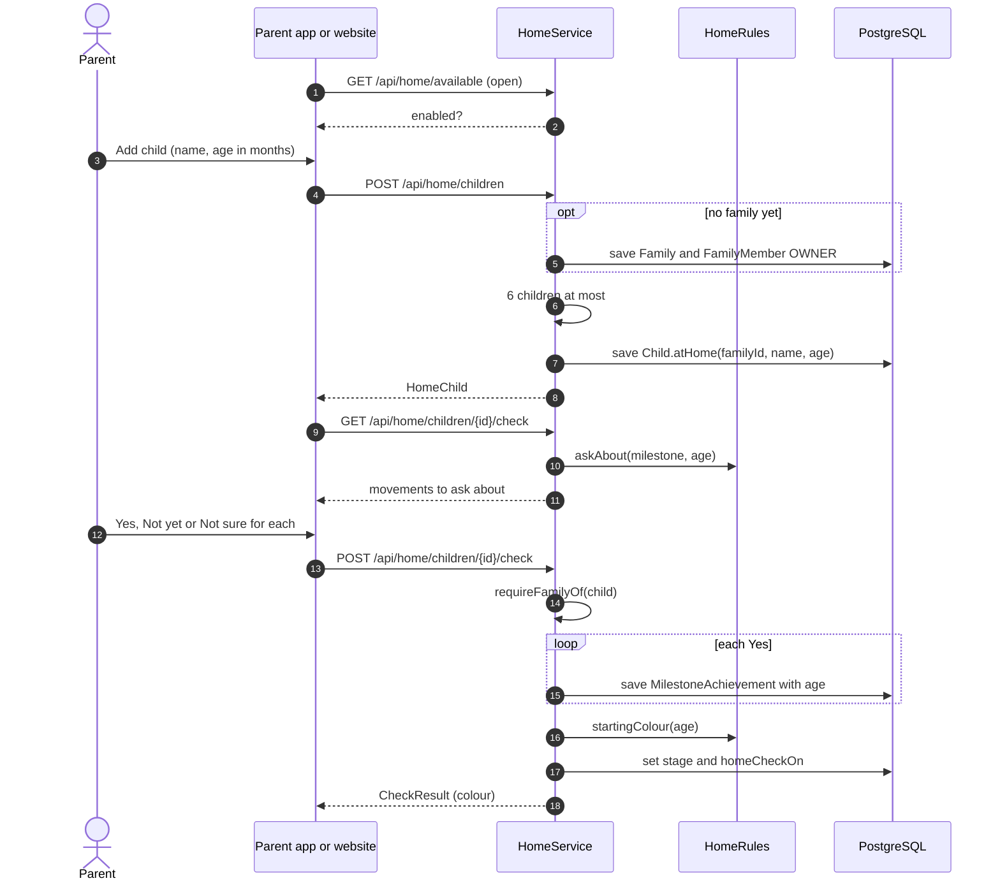
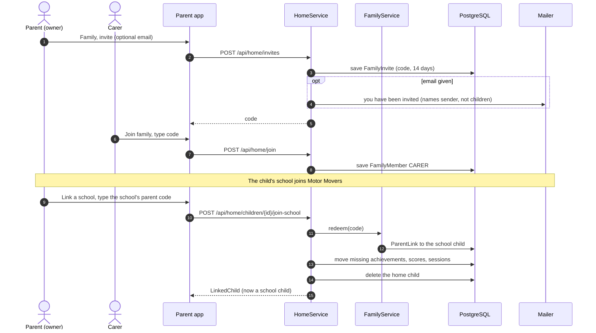

# Parent (Motor Movers at Home): sequence diagrams

Families whose school is not on Motor Movers. Behind HOME_PROGRAMME, off in production.

The app asks which country the parent is in at first launch: see [First launch](5a-parent-school-child.md#first-launch).

[All roles](README.md) · Traced from the code at commit 93da753 (4 Nov 2026). Errors are problem details: 400 a rule broken, 403 no access, 429 a rate limit. When an endpoint or rule shown here changes, update the diagram in the same pull request.

## Flows

1. [Add a child and do the starting check](#home-add-check)
2. [Today's home session and ratings](#home-today)
3. [Share with another carer, or move to a school](#home-family)

## Add a child and do the starting check

The first child creates the family. The check asks about movements up to the child's age and sets the starting colour.

**Endpoints:** `GET /api/home/available` · `POST /api/home/children` · `GET /api/home/children/{id}/check` · `POST /api/home/children/{id}/check`

**Rules in the code**

- Up to 6 children a family.
- Children start at Orange when young and Green from school age (Red under 2, to confirm).
- The check only records movements. It is suggested again at the start, middle and end of each school year.

## Today's home session and ratings

HomeRules builds today's plan: one rhyme a week for the rhyme colours, modules built up over five weeks from Green on.

**Endpoints:** `GET /api/home/children/{id}/today` · `GET /api/home/induction` · `POST /api/home/induction/lessons/{id}/complete` · `POST /api/home/sessions` · `POST /api/assessment/exercise-scores` · `GET /api/home/children/{id}`

**Rules in the code**

- A parent finishes the parent induction before their first session; each carer does their own. The API refuses a
  session until then, and finishing is permanent: lessons added later lock nobody out.
- The safety note shows before the first session.
- From Green to Indigo the session ends with the module's cool-down (the latest one sent for that colour); a rhyme
  ends with its own, in its words (Pat, 2026-11-05).
- Parents rate with the same 1 to 4 scale. A flag shows only the gentle prompt (nursery or health visitor).

## Share with another carer, or move to a school

An owner invites a carer by code or email. If the child's school joins later, the home record moves onto the school's record.

**Endpoints:** `POST /api/home/invites` · `POST /api/home/join` · `DELETE /api/home/members/{id}` · `POST /api/home/children/{id}/join-school`

**Rules in the code**

- Invite emails: 20 a day per account. Joining: 10 tries an hour.
- The last member leaving deletes the family and its records.
- On join-school the school's own rows win; only missing ones move across.
