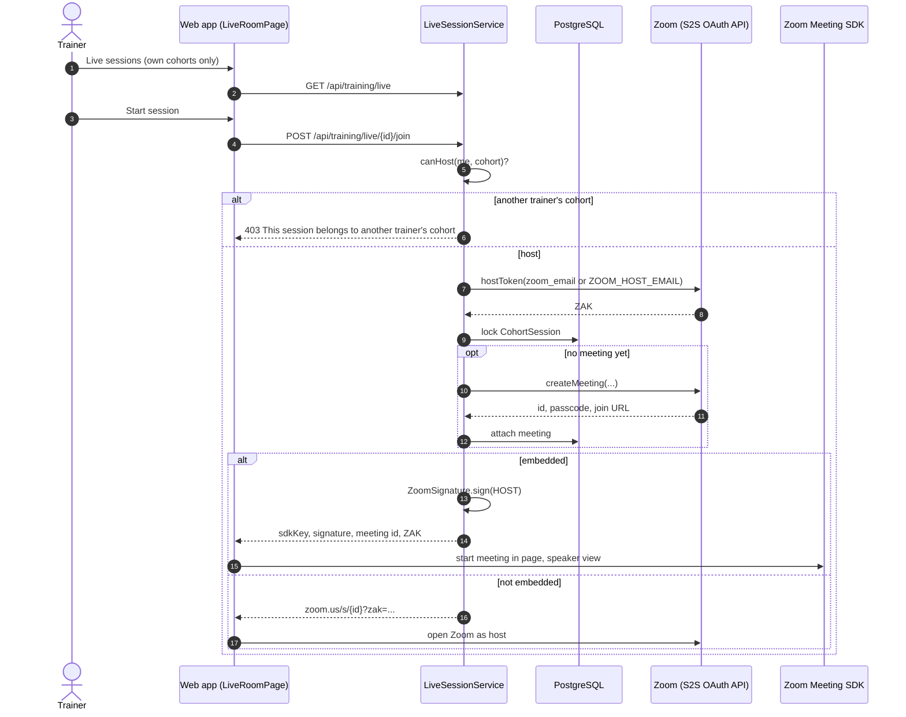
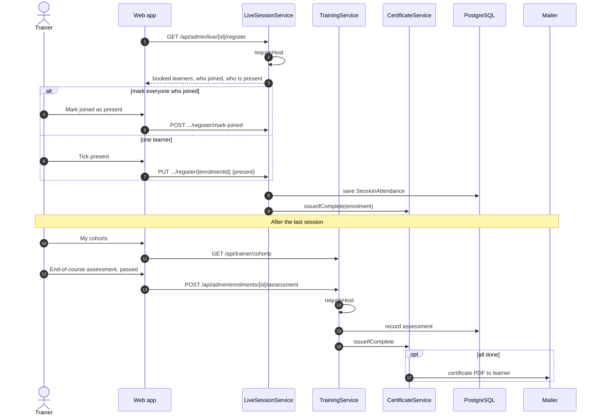

# Trainer: sequence diagrams

Only the cohorts the team assigns: run sessions on Zoom and keep the register.

[All roles](README.md) · Traced from the code at commit 93da753 (4 Nov 2026). Errors are problem details: 400 a rule broken, 403 no access, 429 a rate limit. When an endpoint or rule shown here changes, update the diagram in the same pull request.

## Flows

1. [Start a live session as host](#host)
2. [Register, end-of-course assessment and certificates](#register)

## Start a live session as host

The trainer's own Zoom login hosts, so sessions can run at the same time. The portal embeds the meeting beside the rules and register.

**Endpoints:** `GET /api/training/live` · `POST /api/training/live/{id}/join`

**Rules in the code**

- canHost: the cohort's trainer or the team. Another trainer gets 403.
- The host token is fetched before the row lock, so a Zoom refusal creates no meeting.
- Host user is the trainer's zoom_email, else ZOOM_HOST_EMAIL.

## Register, end-of-course assessment and certificates

During the session the trainer marks who is present (or everyone who joined). After the course they record pass or not.

**Endpoints:** `GET /api/admin/live/{id}/register` · `POST /api/admin/live/{id}/register/mark-joined` · `PUT /api/admin/live/{id}/register/{enrolmentId}` · `GET /api/trainer/cohorts` · `POST /api/admin/enrolments/{id}/assessment`

**Rules in the code**

- Attendance cannot change once the certificate is issued.
- Every register mark and assessment re-checks certificate eligibility.
