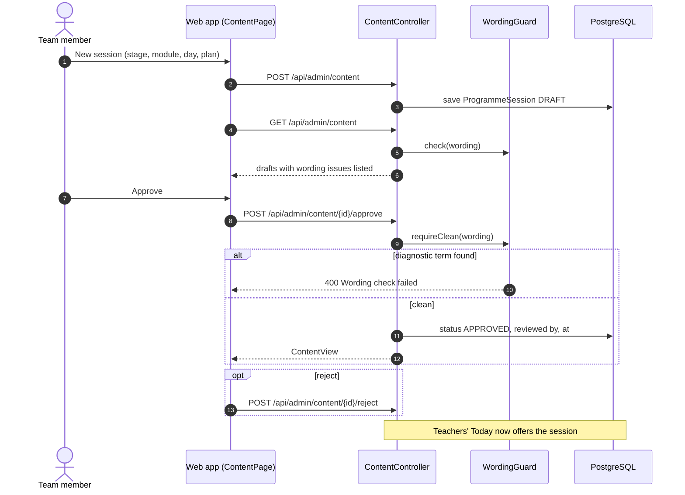
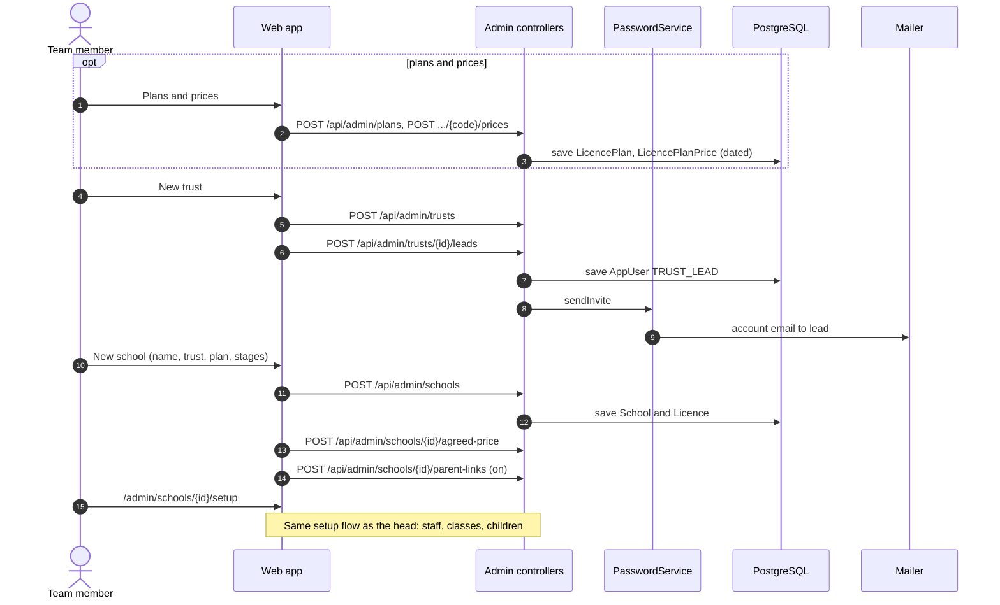
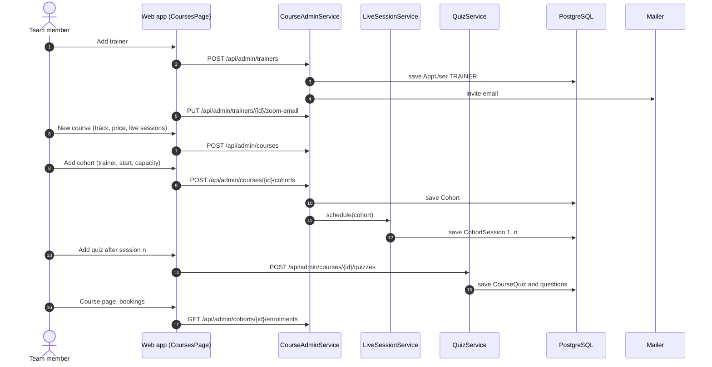
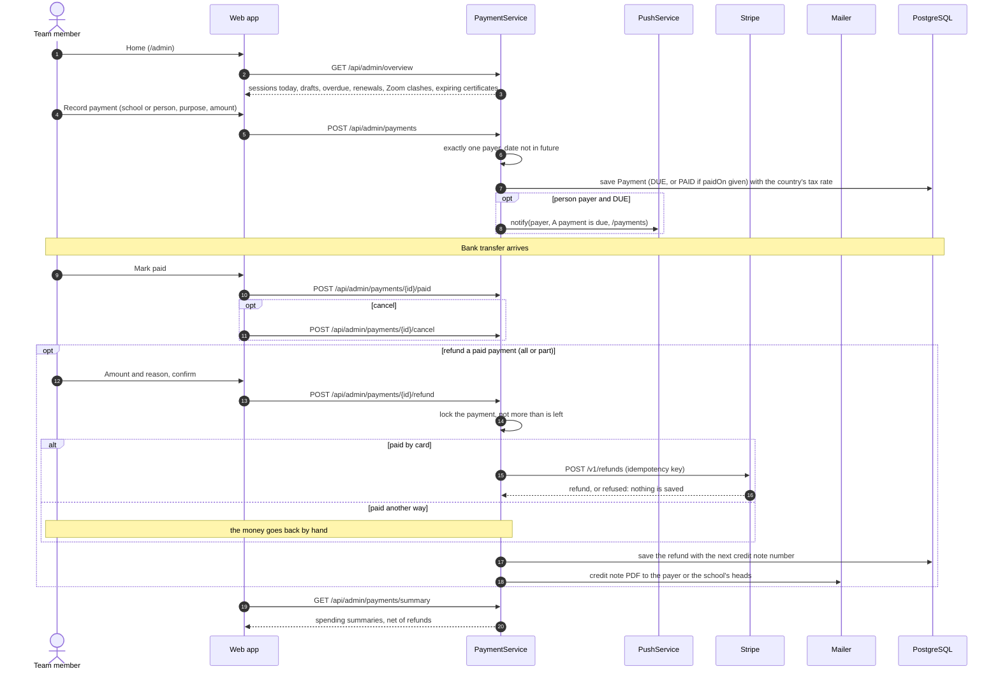

# Motor Movers team (admin): sequence diagrams

Content, schools and licences, courses and trainers, plans, prices and payments.

[All roles](README.md) · Traced from the code at commit 93da753 (4 Nov 2026). Errors are problem details: 400 a rule broken, 403 no access, 429 a rate limit. When an endpoint or rule shown here changes, update the diagram in the same pull request.

## Flows

1. [Write and approve content](#content)
2. [Sign up a trust and a school](#sign-up-school)
3. [Courses, cohorts, quizzes and trainers](#courses)
4. [Record payments and the team's home page](#payments-admin)

## Write and approve content

Sessions, home activities, guidance, resources and induction lessons start as drafts. Approval runs the wording guard. A
film, recording or printable is a pasted link, or a file uploaded first: `POST /api/admin/files` (ADMIN; type and size
checked) gives an upload link, the browser sends the file straight to the store, and the form saves its key. The draft
shows Open the file. The content page alone may reach the store, so it opens with a full page load.

**Endpoints:** `POST /api/admin/content` · `GET /api/admin/content` · `POST /api/admin/content/{id}/approve` · `POST /api/admin/content/{id}/reject`

**Rules in the code**

- Diagnostic terms block approval (WordingGuard).
- Only approved content reaches teachers and parents.
- The same pattern covers /home-activities, /guidance, /resources and /induction.
- An upload link takes one file of the agreed type and size; video, audio, PDF and image types only.
- An uploaded file gets a signed link only after the reader's access checks; pasted links are sent as they are.

## Sign up a trust and a school

The team signs schools up: trust and lead, school with plan and licence, an agreed price, parent links, then setup.

**Endpoints:** `POST /api/admin/trusts` · `POST /api/admin/trusts/{id}/leads` · `POST /api/admin/schools` · `POST /api/admin/schools/{id}/agreed-price` · `POST /api/admin/schools/{id}/parent-links` · `POST /api/admin/plans/{code}/prices`

**Rules in the code**

- There is no self-service school sign-up yet.
- Prices are dated, so a new price applies from its date.

## Courses, cohorts, quizzes and trainers

Adding a cohort schedules its live sessions. Trainers get an invite and their own Zoom login.

**Endpoints:** `POST /api/admin/trainers` · `PUT /api/admin/trainers/{id}/zoom-email` · `POST /api/admin/courses` · `POST /api/admin/courses/{id}/cohorts` · `PUT /api/admin/cohorts/{id}` · `POST /api/admin/courses/{id}/quizzes` · `GET /api/admin/cohorts/{id}/enrolments`

**Rules in the code**

- A quiz that learners have taken cannot be deleted, only changed.
- Changing a cohort reschedules its sessions.

## Record payments and the team's home page

The team records invoices for schools or people and marks bank transfers paid. Home lists today's sessions, drafts, overdue invoices and renewals.

**Endpoints:** `POST /api/admin/payments` · `POST /api/admin/payments/{id}/paid` · `POST /api/admin/payments/{id}/cancel` · `POST /api/admin/payments/{id}/refund` · `GET /api/payments/refunds/{id}/credit-note.pdf` · `GET /api/admin/payments/summary` · `GET /api/admin/overview`

**Rules in the code**

- The payer is a school or a person, not both. Team accounts never pay.
- A DUE payment for a person also goes to their phone.
- A payment stays PAID when refunded; several part refunds are allowed, never more than was paid. Totals are net, and in
  spend by month a refund counts in the month the money went back.
- Credit note numbers have no gaps per deployment: a refund Stripe refuses takes no number.
- A repeated request (same `clientId`, same payment) changes nothing; the same `clientId` on another payment is refused.
- Prices include tax. A payment keeps the tax rate in force when it was created (`tax_rate_bp`); payment views show
  "includes VAT £x" (amount x rate / (1 + rate), rounded to the minor unit). Older payments have no rate and no tax line.
