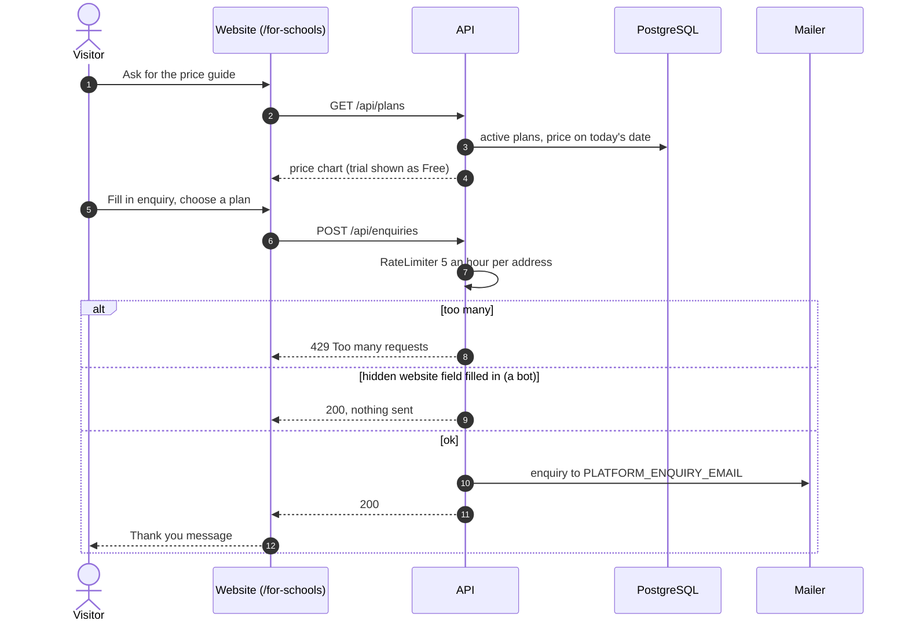
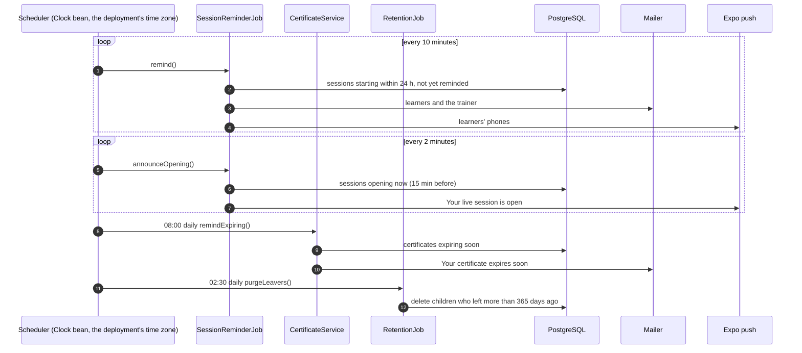

# Visitor and scheduled jobs: sequence diagrams

The public website without signing in, and the jobs that run on their own.

[All roles](README.md) · Traced from the code at commit 93da753 (4 Nov 2026). Errors are problem details: 400 a rule broken, 403 no access, 429 a rate limit. When an endpoint or rule shown here changes, update the diagram in the same pull request.

## Flows

1. [Price chart and enquiry form](#enquiry)
2. [Scheduled jobs](#jobs)

## Price chart and enquiry form

For schools shows the active plans at today's price and an enquiry form. The enquiry is emailed, not stored.

**Endpoints:** `GET /api/plans` · `POST /api/enquiries`

**Rules in the code**

- Both are open without signing in.
- 5 enquiries an hour per address, and a hidden field catches bots.
- Sent to PLATFORM_ENQUIRY_EMAIL (the owner's address for now).

## Scheduled jobs

Four jobs run on the API's clock (the deployment's time zone): session reminders, session opening, certificate expiry and deleting leavers.

**Endpoints:** `SessionReminderJob.remind` · `SessionReminderJob.announceOpening` · `CertificateService.remindExpiring` · `RetentionJob.purgeLeavers`

**Rules in the code**

- Time always comes from the Clock bean.
- Rate limits and job state are per API instance today.
